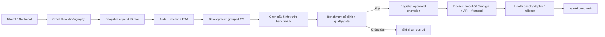

# Kiến trúc và các quyết định kỹ thuật

Project có một package Python và một frontend. Notebook chỉ để đọc/giải thích kết quả. Local và GitHub Actions đều gọi cùng CLI, không có một bản pipeline riêng cho từng môi trường.

## Hợp đồng dữ liệu

`ingestion/sources.py` chỉ parse phản hồi nguồn. `normalization.py` ánh xạ về schema 18 cột, giữ nguyên tiếng Việt. `crawler.py` quản lý phân trang, giới hạn ngày, cache, retry và dedup ID. Chỉ hai category được chấp nhận: `can_ho_chung_cu`, `nha_tro`.

Snapshot giữ bản ghi đầu tiên của mỗi ID. Các lần quan sát mới của cùng ID còn trong raw cache; không âm thầm sửa giá/tiêu đề đã được review. Đây là một bảng tích luỹ các tin, không phải bảng kiểm kê tất cả căn đang còn cho thuê. Lựa chọn này giữ được ngữ cảnh review và benchmark; một hệ thống theo dõi giá thay đổi theo thời gian cần thêm bảng observations riêng.

`posted_date` là ngày do nguồn hiển thị; tin được đẩy lại có thể đổi ngày này. `scraped_at` ở dữ liệu cũ từng là ngày parse. Manifest crawl mới có timestamp thực thi và raw cache theo ngày. Không suy luận xu hướng giá từ hai snapshot crawl thuận tiện này.

## Chất lượng và review

Audit kiểm tra giá theo tháng, đối chiếu text/numeric và đơn vị m², scope đáng ngờ, tin ở ghép, schema/ID/city, diện tích và số phòng. Unknown giữ đúng ý nghĩa; không coi thiếu nội thất là nhà trống. Trường chưa được kiểm chứng không được đoán nhãn chỉ để tăng số tin hợp lệ.

`bedrooms` gốc được giữ nguyên để truy vết. `bedrooms_analysis` chỉ mô tả **phòng ngủ riêng**, và `bedrooms_origin` ghi nguồn bằng chứng. Tiêu đề có cấu trúc rõ như `studio`, `1PN` hoặc `2N1K` có thể cung cấp số phòng; studio được biểu diễn bằng 0, còn chưa rõ vẫn là missing. Tiêu đề mâu thuẫn hoặc số phòng không hợp lý được đánh dấu thay vì đoán. Với phòng trọ, số phòng có cấu trúc từ nguồn nhưng thiếu mô tả layout rõ bị coi là chưa xác minh vì có thể là tổng số phòng trong toà nhà.

Review queue lưu quyết định cùng reviewer/note và đối chiếu title/price_raw/area_raw trước khi áp dụng lại. Một quyết định cũ không được áp vào nội dung đã đổi. Các flags thuộc dữ liệu kiểm tra không được dùng làm predictor.

## Huấn luyện và đánh giá

- Target: giá chào thuê dương VND/tháng. Feature cơ bản: category, district, area; phòng ngủ riêng và nội thất được so sánh bằng ablation. Với mỗi category, bedroom feature bị bỏ nếu độ phủ phòng ngủ đủ tin cậy trong chính tập training dưới 35%; không lấy độ phủ benchmark để quyết định.
- Hai baseline: global median và category median. Grid chẩn đoán gồm 8 Ridge và 16 Random Forest không ràng buộc. Grid được phép chọn phục vụ gồm 8 HistGradientBoosting và 4 Random Forest có ràng buộc đơn điệu, huấn luyện riêng theo category, với direct/log target và 5-fold grouped CV trên development. Champion `ec9a7bf02b42ae3b` là HistGradientBoosting loss `squared_error`, target log, ablation C; phòng trọ bỏ bedroom feature do coverage dưới 35%.
- Hợp đồng hành vi: khi giữ nguyên category, quận, nội thất và các đầu vào khác, tăng diện tích hoặc số phòng ngủ riêng đã biết trong miền layout hợp lệ không được làm giá giảm. Đây là giả định sản phẩm được kiểm tra bằng `behavior.py`, không phải kết luận nhân quả từ dữ liệu. Unknown không có thứ tự so với studio 0; không yêu cầu tăng phòng phải làm giá tăng nghiêm ngặt.
- Căn hộ và phòng trọ là hai nhóm nguồn có thể chồng lấn về phân khúc. Không áp đặt bất đẳng thức “căn hộ luôn đắt hơn phòng trọ”; category không phải thang chất lượng có thứ tự.
- Imputation, missing indicators, one-hot encoding và scaling được fit trong mỗi training fold. Không fit trước trên toàn bộ dữ liệu.
- Một nhóm tin trùng tiềm năng không vượt qua ranh giới train/validation/test. Khi thêm tin mới trùng nhóm benchmark, peer mới bị quarantine khỏi development.
- `data/benchmark/ids.csv` khóa 432 ID từ tập kiểm tra căn hộ/phòng trọ đã có. Dữ liệu benchmark không được train. Cấu hình được chọn bằng OOF trước khi tính benchmark.
- MAE dùng đơn vị gốc làm metric chính; RMSE cho thấy lỗi lớn; R² là chỉ số bổ sung và không phải phần trăm dự đoán đúng. Metrics được báo theo loại căn và nguồn.

Benchmark này đã được xem trong EDA, được dùng khi quyết định bỏ nhà riêng và sẽ tái dùng cho gate. Nó là regression benchmark vận hành. Lặp lại nhiều lần có thể khiến quyết định thích nghi với benchmark; cần giữ thêm các cohort thời gian mới để kiểm tra độc lập, và có quy trình version benchmark định kỳ. Không quảng bá điểm này như ước lượng không thiên lệch cho thị trường tương lai.

## Gate và registry

`config/promotion.json` là policy được version cùng code. Mặc định yêu cầu:

| Điều kiện | Ngưỡng |
| --- | --- |
| Development / benchmark | Ít nhất 500 / 100 tin |
| Benchmark mỗi loại | Ít nhất 30 tin |
| MAE chung | Tối đa 2,5 triệu VND/tháng |
| MAE căn hộ / phòng trọ | Tối đa 3,5 / 1,5 triệu |
| Tốt hơn category baseline | Ít nhất 10% |
| Tốt hơn champion trên cùng benchmark | Ít nhất 1% khi đã có champion |
| Mỗi loại so với champion | Không tệ hơn quá 5% |
| Hành vi diện tích/phòng ngủ | Không có bước giảm trong phép thử các layout hợp lệ, giữ các trường khác cố định |
| Tỷ lệ loại khỏi tập giá | Không quá 15% |
| Thiếu diện tích trong tập giá | Không quá 50% |
| PSI diện tích so với dữ liệu champion | Không quá 0,25 |
| Crawl trong `refresh` | Không lỗi nguồn và đã tới ranh giới đã báo cáo |

Các con số này là ngân sách chất lượng ban đầu của project, chưa phải tiêu chuẩn ngành hoặc cam kết độ chính xác. Không chỉnh chúng sau khi thấy benchmark chỉ để làm một candidate được deploy.

Có một ngoại lệ sửa hợp đồng hành vi: khi phép thử chứng minh champion cũ có bước giảm diện tích/phòng ngủ trái hợp đồng, candidate đã sửa có thể thay champion mà không cần cải thiện MAE ít nhất 1%. Ngoại lệ này giới hạn mức tăng MAE chung tối đa 10%; ngưỡng suy giảm mỗi loại 5%, các ngân sách MAE tuyệt đối, baseline và data-quality checks vẫn áp dụng. Cần lưu cả bằng chứng vi phạm của champion lẫn kết quả candidate; không dùng ngoại lệ cho mọi lần retrain.

Lần promote `ec9a7bf02b42ae3b` có 0 vi phạm trên 5,292 probe rows, legacy có 1,719 vi phạm khi đánh giá lại cùng semantics. Candidate giảm MAE chung từ 1,559,244.68 xuống 1,544,409.34 VND/tháng, khoảng 0.9514%, nên được xét qua nhánh sửa hợp đồng. Nhóm phòng trọ tăng MAE khoảng 4.32% và vẫn trong guard 5%. Tập benchmark 432 ID/target và population giá được giữ nguyên. [Verification report](../reports/verification_behavior.json) lưu kiểm tra checksum, group isolation và state round-trip; kết quả local có 52 pytest/4 browser E2E đạt, chưa xác minh Docker build hoặc triển khai từ xa.

`artifacts/models/<version>/` giữ model, metadata, metrics, market aggregates, training IDs và snapshot code huấn luyện. `artifacts/registry.json` giữ lịch sử quyết định và pointer champion; ghi file bằng replace để tránh JSON bị ghi dở. `reports/` phản ánh candidate mới nhất kể cả khi bị từ chối. Web luôn đọc model/profile của champion, nên không trộn số liệu của candidate vào prediction đang phục vụ.

Champion trong registry là model được chấp nhận để đóng gói. Phiên bản thực sự chạy ngoài máy chủ được xác nhận bằng `/api/health` và deployment log; build hoặc push image không chứng minh đã deploy thành công.

## Serving và giao diện

FastAPI load model một lần khi khởi động. Form yêu cầu category, district và area; bedrooms/furnishing được phép bỏ trống. Studio hoặc phòng khép kín không có phòng ngủ ngăn riêng dùng bedrooms=0; chưa biết layout thì để trống. `layout.py` dùng quy tắc sản phẩm `8 + 10 × số phòng ngủ riêng ≤ diện tích m²`, đồng thời giới hạn căn hộ tối đa 6 và phòng trọ tối đa 2 phòng ngủ riêng. Ví dụ 10 m²/5 phòng ngủ bị từ chối. Đây là heuristic hợp lý đầu vào cho ứng dụng, không phải quy chuẩn xây dựng hay xác minh bản vẽ.

API công bố layout policy để frontend dùng cùng giới hạn. Backend tiếp tục kiểm tra vì client có thể gọi trực tiếp. API trả giá, phiên bản, feature thực sự được dùng cho category đó, số tin hỗ trợ trong training, cảnh báo và sai số lịch sử. Nếu bedroom feature bị loại do thiếu coverage, UI phải nói rõ và không hàm ý thay đổi trường đó sẽ đổi giá. UI không biến MAE thành prediction interval; nhóm căn/quận/diện tích quá ít tin phải có cảnh báo yếu dữ liệu, không mượn số lượng toàn bộ quận để che độ thưa cục bộ.

Giao diện mới hướng đến bố cục sổ số liệu trung tính: label và đơn vị rõ, phân biệt studio 0 với chưa rõ, màu teal dành cho dữ liệu giá, cảnh báo nằm gần đầu vào/kết quả liên quan. Việc thay giao diện phải được kiểm tra trong trình duyệt sau khi code hoàn tất; các lựa chọn thiết kế chưa tự chứng minh luồng tương tác đã qua QA.

API không thu tên, số điện thoại hoặc địa chỉ căn cụ thể. Market endpoint chỉ có aggregates. Telemetry chỉ có route/status/count/duration, không log form nhập. Hiện đây là dịch vụ dự đoán công khai, không có chức năng tài khoản hay thanh toán.

## Môi trường và độ bền state

`requirements.lock` / `requirements-dev.lock` và `frontend/package-lock.json` khóa dependency. Docker build chỉ cài package và đóng gói champion đã có; không train lại bên trong build. CI smoke test kiểm tra chính artifact sẽ đưa lên web.

GitHub runner là tạm thời. Trước mỗi đợt refresh, workflow restore snapshot, benchmark và registry từ release `rental-state`, xác minh SHA-256 rồi giải nén với allowlist. Sau đánh giá, state được lưu ở release phiên bản `rental-state-<runid>-<attempt>` và pointer latest. Lỗi auth/network/checksum làm restore thất bại; chỉ 404 của pointer lần đầu cho phép bootstrap từ repo.

Raw response nằm ngoài Git, phục vụ tái parse ở local. State release giữ dữ liệu canonical, review, benchmark và model; raw archive không tự động được công bố. Báo cáo coverage và source hashes là thông tin truy vết, không chứng minh đã có mọi tin đã từng tồn tại.

Cron chạy 00:35 ngày 1 theo giờ Việt Nam để xử lý tháng vừa kết thúc. GitHub schedule có thể trễ và cần workflow trên default branch. Manual dispatch dùng cho backfill hoặc chạy bù. Chỉ một job được cập nhật monthly state tại một thời điểm.
