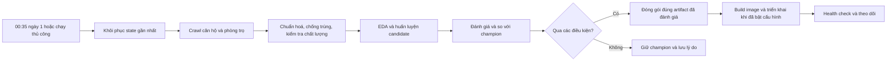

# Đề tài: Hanoi Rent Insight

**Xây dựng website ước lượng giá chào thuê căn hộ và phòng trọ tại Hà Nội, kết hợp pipeline dữ liệu và MLOps tự động bằng GitHub Actions.**

**Tình trạng bàn giao:** sản phẩm được chuẩn bị để chạy local, gồm frontend, API và model đã chọn. Người dùng hiện chưa có VPS/domain nên triển khai từ xa chưa được bật và chưa được xác minh. Repo có sẵn workflow và [hướng dẫn triển khai](DEPLOYMENT.md) để sử dụng khi có hạ tầng.

## 1. Bài toán sản phẩm giải quyết

Khi tìm phòng trọ hoặc căn hộ, người thuê thường phải mở nhiều tin đăng, tự so sánh giá, diện tích, vị trí và nội thất. Những tin có mức giá gần nhau có thể thuộc loại bất động sản rất khác nhau. Một mức giá thấp cũng có thể là giá theo người, theo ngày hoặc giá không bao gồm toàn bộ căn. Việc so sánh bằng mắt vì vậy tốn thời gian và dễ dẫn đến kết luận sai.

Chủ nhà cũng gặp vấn đề tương tự khi xác định giá chào thuê ban đầu. Nếu chỉ dựa vào một vài tin trong khu vực, họ có thể bỏ qua sự khác biệt về diện tích, loại căn hoặc nội thất. Trong khi đó, một mô hình huấn luyện một lần sẽ dần dùng thông tin cũ nếu không được cập nhật và kiểm tra lại.

Sản phẩm giúp người dùng nhập đặc điểm căn cần thuê hoặc cho thuê và nhận **một mức giá chào thuê tham khảo theo tháng**, cùng thông tin về phạm vi dữ liệu, phiên bản mô hình và những giới hạn của dự đoán. Hệ thống phía sau tự thu thập dữ liệu định kỳ, kiểm tra chất lượng, huấn luyện ứng viên và quyết định có thay mô hình đang phục vụ hay không.

Website hỗ trợ hai quyết định cụ thể:

1. Người thuê sàng lọc nhanh xem ngân sách dự kiến có phù hợp với đặc điểm căn mình muốn tìm hay không.
2. Người cho thuê có thêm một mốc tham khảo trước khi chọn giá đăng, sau đó đối chiếu với thực tế căn và các tin tương tự.

Giá đích là **giá chào thuê trong tin đăng**, chưa phải mức giá hai bên đã ký hợp đồng. Website chưa thay thế việc xem căn, kiểm tra hợp đồng hoặc thẩm định bất động sản.

## 2. Người dùng và tình huống sử dụng

| Nhóm người dùng | Nhu cầu | Website hỗ trợ như thế nào? |
| --- | --- | --- |
| Sinh viên, người mới đi làm | Ước lượng ngân sách phòng trọ trong khu vực | Nhập loại phòng, vị trí, diện tích và thông tin bổ sung để nhận giá tham khảo |
| Người thuê căn hộ, gia đình nhỏ | So sánh các phương án diện tích hoặc số phòng ngủ | Thay đổi đầu vào, xem dự đoán thay đổi và đọc giới hạn dữ liệu |
| Chủ căn hộ/phòng cho thuê | Chọn giá chào ban đầu có căn cứ | Đối chiếu mức giá dự kiến với dự đoán từ mẫu tin đăng đã xử lý |
| Nhóm nghiên cứu, giảng viên | Đánh giá một hệ thống ML hoàn chỉnh | Theo dõi từ dữ liệu, baseline, mô hình đến kiểm thử API, registry và triển khai |

**Ví dụ minh hoạ, không phải một dự đoán đã được xác minh:** người dùng muốn thuê căn hộ 60 m² ở Cầu Giấy, có hai phòng ngủ và đầy đủ nội thất. Thay vì nhập một mức giá rồi yêu cầu hệ thống chứng minh mức đó hợp lý, họ cung cấp đặc điểm căn; website trả giá dự đoán từ mô hình đang được chọn. Nếu đổi diện tích hoặc nội thất, người dùng có thể xem kết quả mới. Sự thay đổi dự đoán thể hiện quan hệ học được từ dữ liệu, chưa chứng minh tác động nhân quả của từng đặc điểm.

## 3. Phạm vi được chọn

- Khu vực: Hà Nội theo cách phân vùng có trong dữ liệu nguồn; cần ghi rõ khi tên quận/huyện là đơn vị trước sắp xếp hành chính.
- Loại tin: căn hộ/chung cư (`can_ho_chung_cu`) và phòng trọ (`nha_tro`).
- Đơn vị giá: VND/tháng cho toàn căn hoặc toàn phòng theo phạm vi đã kiểm tra.
- Đơn vị diện tích: m².
- Nguồn mẫu ban đầu: Nhatot và Alonhadat.
- Nhà riêng (`nha_rieng`) nằm ngoài phạm vi sản phẩm hiện tại. Không đưa dự đoán loại này lên giao diện.
- Tin văn phòng, mặt bằng kinh doanh, giường ở ghép, giá theo người hoặc giá theo ngày cần được loại hoặc chuyển sang hàng chờ rà soát theo quy tắc dữ liệu.

Hai nhóm căn hộ và phòng trọ được giữ vì nhu cầu sử dụng tương đối rõ hơn so với nhóm nhà riêng trước đây, vốn trộn nhà ở thông thường với nhà mặt phố và mặt bằng giá cao. Quyết định thu hẹp phạm vi giúp sản phẩm dễ diễn giải và đánh giá hơn. Nó không tự chứng minh mô hình mới dự đoán tốt hơn; muốn kết luận cải thiện phải so sánh trên cùng các bản ghi kiểm tra.

## 4. Dữ liệu người dùng nhập và kết quả nhận được

Giao diện cần phân biệt rõ **bắt buộc** và **tuỳ chọn**. Quy tắc cuối cùng của từng trường phải khớp với schema API, không chỉ được kiểm tra ở trình duyệt.

| Thông tin | Ý nghĩa | Cách xử lý |
| --- | --- | --- |
| Loại căn | Căn hộ hoặc phòng trọ | Trường bắt buộc, chỉ chấp nhận hai loại được hỗ trợ |
| Vị trí | Quận/huyện trong phạm vi dữ liệu | Trường bắt buộc; hiển thị danh sách để giảm lỗi gõ |
| Diện tích | Diện tích căn/phòng, đơn vị m² | Trường bắt buộc trên web; nhập số dương trong phạm vi API cho phép |
| Số phòng ngủ riêng | Số phòng ngủ được ngăn riêng của đơn vị thuê | Tuỳ chọn; studio/phòng khép kín không ngăn phòng ngủ là 0, chưa rõ thì để trống |
| Nội thất | Đầy đủ, không có hoặc chưa rõ | Tuỳ chọn; chưa rõ phải được giữ thành một trạng thái riêng |

Các trường như địa chỉ chi tiết, ảnh, tiện ích, tình trạng căn, khoảng cách đến nơi làm việc hoặc số điện thoại chưa tự động trở thành đầu vào ML. Chỉ thêm một trường vào giao diện khi nó có tác dụng trong sản phẩm và đã có dữ liệu/logic xử lý tương ứng. Thu thập nhiều thông tin mà mô hình không sử dụng sẽ làm người dùng hiểu nhầm về độ chính xác.

Ứng dụng kiểm tra tính hợp lý giữa diện tích và số phòng ngủ riêng bằng heuristic `8 + 10 × số phòng ngủ riêng ≤ diện tích m²`, tối đa 6 phòng cho căn hộ và 2 phòng cho phòng trọ. Vì vậy yêu cầu 10 m²/5 phòng ngủ bị chặn. Những giới hạn này là chính sách đầu vào của sản phẩm, không được trình bày như luật hay quy chuẩn xây dựng. Frontend đọc chính sách từ API và backend kiểm tra lại cùng quy tắc.

Mô hình phục vụ áp dụng giả định: trong cùng loại căn, vị trí, nội thất và các điều kiện khác, tăng diện tích hoặc số phòng ngủ riêng đã biết trên layout hợp lệ không làm giá giảm. Nếu dữ liệu phòng ngủ của một category không đủ tin cậy, model có thể bỏ feature này và công khai điều đó trong kết quả. Giả định trên không tạo thứ tự giá giữa hai category: phòng trọ/CHDV/căn hộ mini và căn hộ cũ có thể chồng lấn về chất lượng, nên không ép căn hộ luôn đắt hơn phòng trọ.

Kết quả nên có:

1. Giá chào thuê dự đoán theo **VND/tháng**, định dạng rõ ràng.
2. Tóm tắt các thông tin đã nhập để người dùng phát hiện sai sót.
3. Phiên bản mô hình và thời điểm dữ liệu được cập nhật.
4. Cảnh báo cụ thể khi đầu vào thiếu thông tin hoặc nằm ngoài phạm vi đã đánh giá tốt.
5. Giải thích ngắn về giá chào đăng và giới hạn của ước lượng.

Kết quả cần cho biết feature nào thực sự dùng cho loại căn đang xét và số tin trong training có hỗ trợ khu vực/diện tích đó. Một nhóm chỉ có vài tin phải được đánh dấu hỗ trợ yếu. Không trình bày giá của nhóm như kết luận chắc chắn về thị trường chỉ vì tổng dữ liệu toàn project lớn. Các ví dụ hành vi và cách giải thích nằm trong [MODEL_BEHAVIOR.md](MODEL_BEHAVIOR.md).

Không gắn nhãn “chính xác 95%” hoặc tự tạo khoảng giá có ý nghĩa xác suất khi hệ thống chưa hiệu chỉnh và kiểm định khoảng dự đoán. MAE của cả tập kiểm tra cũng không phải biên sai số chắc chắn cho một căn cụ thể.

## 5. Giá trị của phần MLOps

Điểm cần chứng minh của đề tài là khả năng duy trì một dịch vụ ML có kiểm soát sau lần huấn luyện đầu tiên. Một lần crawl thành công không đủ để kết luận dữ liệu mới tốt. Một mô hình vừa được train xong cũng không đương nhiên tốt hơn mô hình đang phục vụ.

Luồng vận hành dự kiến:

GitHub Actions điều phối luồng. Workflow `monthly.yml` được cấu hình chạy **00:35 ngày 1 theo `Asia/Ho_Chi_Minh`**, đánh giá tháng vừa kết thúc; cách này xử lý được tháng 28, 29, 30 hoặc 31 ngày. Chạy thủ công cho phép truyền `since` và `until` để backfill. Docker giữ môi trường phục vụ nhất quán. Model registry giữ metadata và lịch sử quyết định. Dữ liệu/state được lưu bền vững trong GitHub Release assets thay vì chỉ để trên runner tạm thời. Những lần không triển khai vẫn có giá trị vì báo cáo cho biết candidate bị chặn ở bước nào.

Phát hành image lên GHCR chỉ được bật bằng biến repository `ENABLE_IMAGE_PUBLISH=true`. Triển khai SSH là bước riêng, chỉ bật `ENABLE_DEPLOY=true` khi đã chuẩn bị VPS và secrets. Với trạng thái hiện tại, demo sản phẩm dùng `./scripts/run_local.sh` và truy cập local ở cổng 8000.

## 6. Mục tiêu đánh giá thành công

| Mặt đánh giá | Điều cần chứng minh |
| --- | --- |
| Chất lượng dữ liệu | Không còn nhà riêng trong tập đang dùng; đơn vị giá đúng; ID không trùng; có báo cáo độ thiếu và độ phủ theo thời gian/nguồn |
| Chất lượng ML | Tốt hơn baseline phù hợp trên cùng dữ liệu kiểm tra; sai số được báo cáo riêng cho căn hộ và phòng trọ |
| Hành vi sản phẩm | Studio 0 khác chưa rõ; chặn layout ngoài heuristic; kiểm tra giá không giảm theo diện tích/phòng ngủ riêng khi giữ các yếu tố khác cố định |
| Tính tổng quát | Không để nhóm tin đăng lại vượt qua train/validation; có đánh giá theo thời gian khi đủ dữ liệu |
| Chức năng web | Nhập hợp lệ trả dự đoán; nhập sai trả lỗi dễ hiểu; model chưa sẵn sàng có trạng thái rõ ràng |
| Khả năng vận hành | Một lần chạy có thể truy vết dữ liệu, code, model và quyết định triển khai; có khả năng khôi phục champion |
| Tính trung thực | Không đánh đồng giá chào với giá giao dịch, R² với phần trăm dự đoán đúng, hoặc smoke test với chất lượng ML |

Ngưỡng MAE, mức cải thiện và mức giảm chất lượng tối đa theo nhóm phải được đặt trong cấu hình và giải thích trước khi đọc kết quả ứng viên. Không thay đổi ngưỡng sau mỗi lần thấy model chưa qua để buộc nó được deploy.

## 7. Giới hạn phải trình bày

Mẫu tin trên hai website không đại diện chắc chắn cho toàn bộ thị trường Hà Nội. Nguồn có cơ cấu căn khác nhau; tin còn hoạt động cuối tháng có thể khác những tin đã bị xoá đầu tháng. Vì vậy crawl bù tháng 10 chỉ khôi phục những tin mà nguồn vẫn cho truy cập, không bảo đảm thu lại toàn bộ thị trường từ ngày 1.

Đợt backfill tháng 10 hiện bổ sung **3.631 tin** để snapshot có **5.836 tin** căn hộ/phòng trọ, gồm **1.135 tin mới có ngày đăng từ 01–13/10**. Nhatot đã đi đến cuối tập kết quả công khai được nguồn trả về. Alonhadat trả 429 sau 40 trang căn hộ và chặn phần phòng trọ, vì vậy độ phủ nguồn này vẫn chưa đầy đủ. Không dùng con số 5.836 để khẳng định toàn thị trường đã được thu thập. Xem [data card](DATA_CARD.md) và crawl metadata của snapshot hiện tại để đọc chi tiết.

Diện tích, phòng ngủ và nội thất có thể thiếu hoặc được người đăng nhập sai. Tin đăng lại được nhận diện theo các quy tắc bảo thủ, chưa phải hệ thống xác minh bất động sản. Dữ liệu không có nhãn giá giao dịch, chất lượng căn hoặc hợp đồng thực tế.

Một benchmark cố định giúp so sánh candidate với champion, nhưng khi dùng lặp lại nhiều lần nó có nguy cơ trở thành một tập mà nhóm gián tiếp tối ưu theo. Cần giữ các đợt dữ liệu tương lai để đánh giá bổ sung, theo dõi cơ cấu mẫu và cập nhật benchmark theo một quy trình có phiên bản, thay vì sửa tuỳ ý sau khi thấy sai số.

Benchmark hiện tại giữ **432 tin căn hộ/phòng trọ** từ tập kiểm tra đã có; các nhóm tin liên quan được cách ly khỏi development. Benchmark này đã từng được EDA và sử dụng trong quyết định thu hẹp scope, nên kết quả phải được gọi là đánh giá nội bộ tái sử dụng. Luồng `refresh` tích hợp crawl và quality gate sẽ chặn promote nếu crawl chưa đầy đủ; lệnh `train` trên snapshot hiện có phục vụ bootstrap/huấn luyện thủ công và cần được phân biệt rõ với luồng tự động này.

## 8. Đoạn giới thiệu có thể dùng trong báo cáo

> Đề tài xây dựng hệ thống ước lượng giá chào thuê căn hộ và phòng trọ tại Hà Nội nhằm giảm thời gian người dùng tự tổng hợp, đối chiếu các tin đăng có đặc điểm khác nhau. Người dùng cung cấp thông tin về loại căn, vị trí, diện tích và các đặc điểm bổ sung để nhận một mức giá thuê tham khảo theo tháng. Hệ thống kết hợp website, API dự đoán và pipeline MLOps tự động bằng GitHub Actions: thu thập dữ liệu định kỳ, kiểm tra chất lượng, huấn luyện, đánh giá và chỉ triển khai ứng viên đáp ứng các điều kiện đã đặt. Sản phẩm nhấn mạnh khả năng truy vết và duy trì chất lượng mô hình, đồng thời công khai giới hạn của dữ liệu giá chào đăng.
