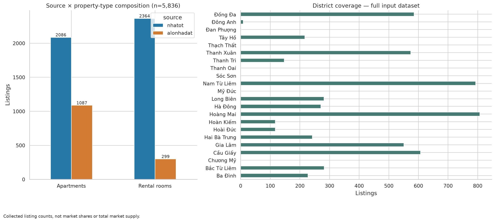
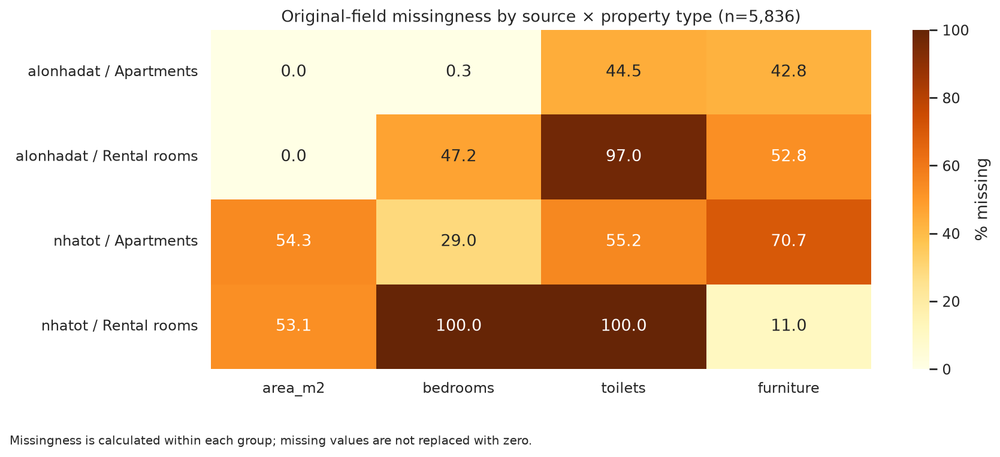
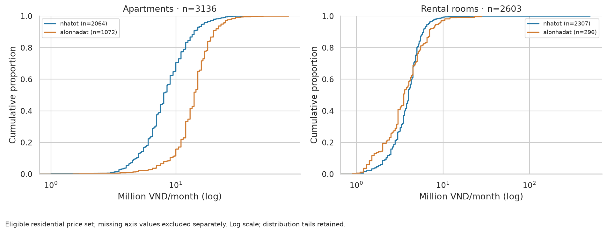
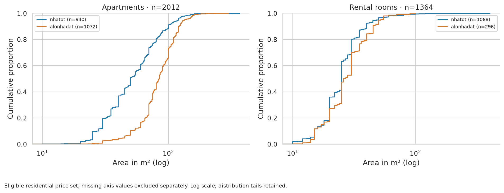
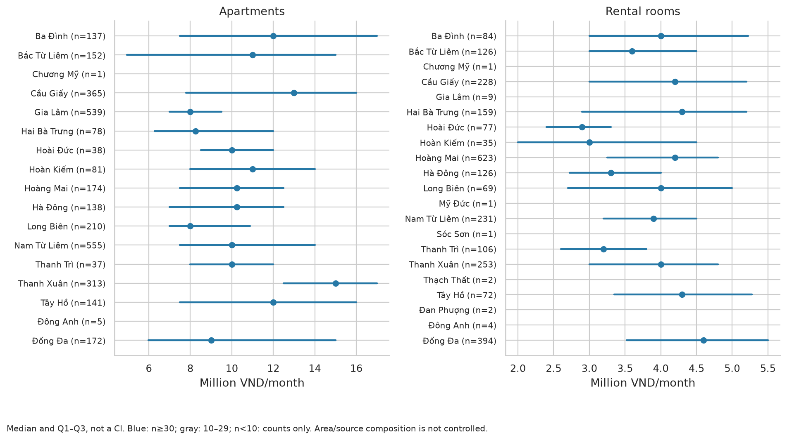
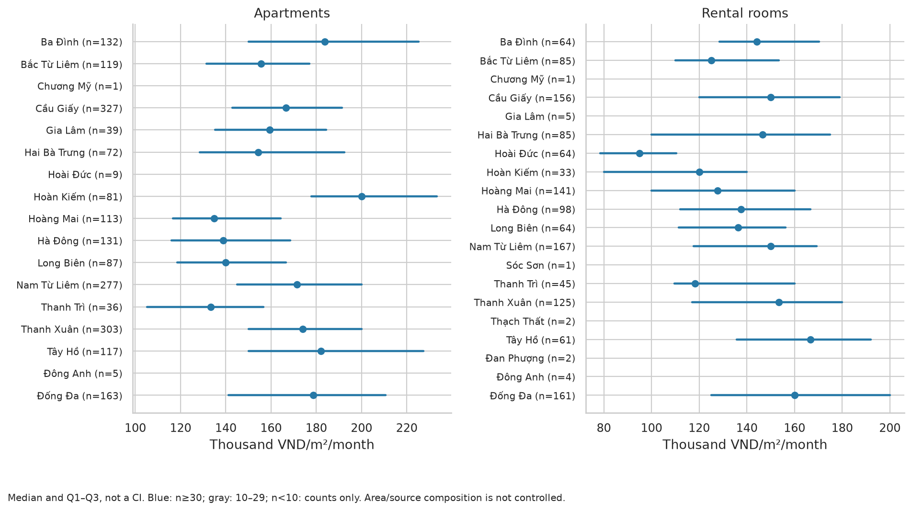
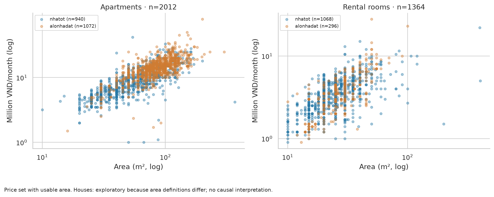
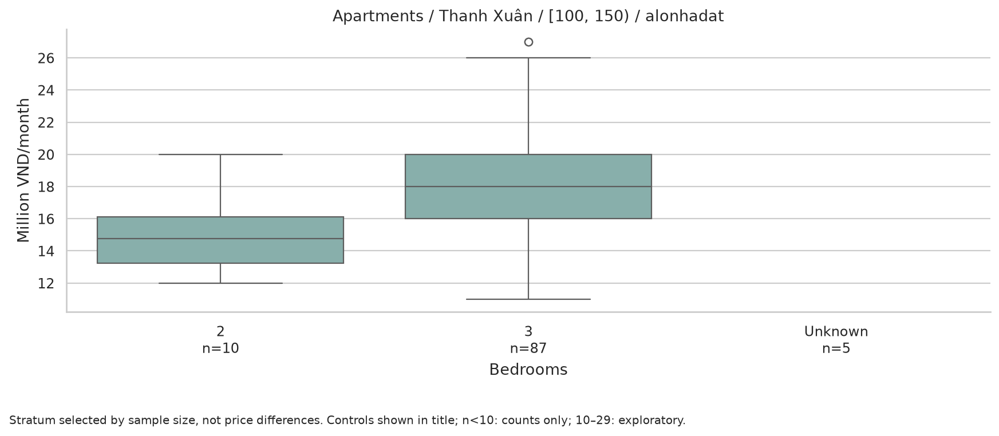
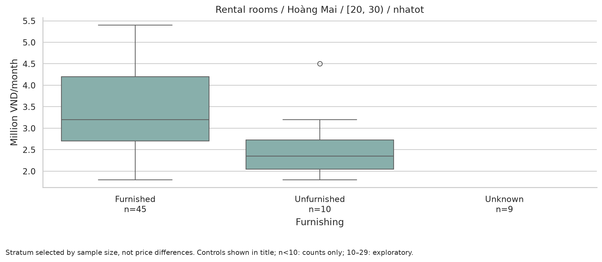
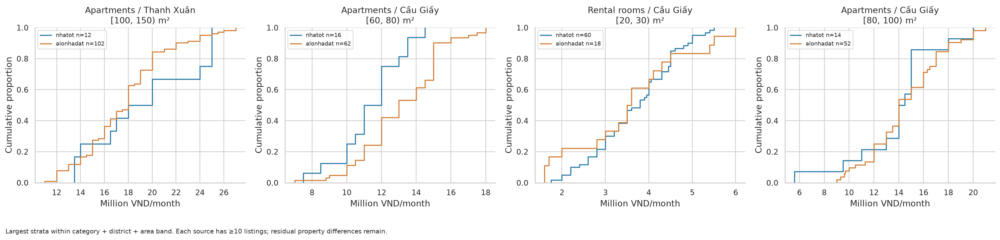

# EDA — Asking rents in the Hanoi listing sample

Generated from `data/analysis/listings_analysis.csv`. This analysis includes apartments and rental rooms only. The observation unit is a listing, not a transaction or a verified unique property. These findings describe an inspected snapshot, not performance on an untouched holdout. Original listing text, source category codes and place names are preserved.

## 1. Data and scope

Input: 5,836 listings. Posting dates: 2026-07-30 to 2026-10-30. `scraped_at`: 2026-09-24, 2026-10-27, 2026-10-30; this records parser execution, not a verified collection date.

| stage | n |
| --- | --- |
| Input | 5836 |
| Flagged (including missing area) | 2731 |
| Review pending | 70 |
| Excluded from price set | 97 |
| Final residential price set | 5739 |
| Final primary price/m² set | 3376 |

Excluded rows remain in the analysis dataset. The review queue stores flags, decisions and evidence. Codex reviewed titles and CSV fields only; source websites were not verified. Unresolved scope/price cases are excluded from the main price set; unresolved area alone removes area from the relevant calculations. Percentile flags do not automatically exclude a listing.

| source | category | input_n | price_n | ppm2_n |
| --- | --- | --- | --- | --- |
| alonhadat | Apartments | 1087 | 1072 | 1072 |
| alonhadat | Rental rooms | 299 | 296 | 296 |
| nhatot | Apartments | 2086 | 2064 | 940 |
| nhatot | Rental rooms | 2364 | 2307 | 1068 |

## 2. Key findings

**1. Sample composition differs between sources.** Rental rooms account for 53.1% of Nhatot listings and 21.6% of Alonhadat listings. An aggregate price comparison cannot separate this composition difference. See Figure 01.

**2. Area availability differs between sources.** Original area missingness is 53.7% on Nhatot and 0.0% on Alonhadat. The price/m² set contains 3,376 apartment and room listings with usable area; it does not represent the entire price set. See Figure 02 and the area-availability comparison below.

**3. Asking rents differ by property type.** Apartments: 10.00 million VND/month, Q1–Q3 7.00–14.00, n=3136; Rental rooms: 4.00 million VND/month, Q1–Q3 3.00–4.90, n=2603. These are asking rents in the filtered sample, not transaction prices. See Figure 03.

| category | n | median | q1 | q3 | p90 |
| --- | --- | --- | --- | --- | --- |
| Apartments | 3136 | 10.00 | 7.00 | 14.00 | 18.00 |
| Rental rooms | 2603 | 4.00 | 3.00 | 4.90 | 6.00 |

**4. District comparisons should stay within the same property type.** The two largest apartment groups meeting n≥30 are shown below, selected by sample size rather than price. Read median differences alongside Q1–Q3. Area and source composition still differ, so the gap cannot be attributed to location alone. This is not a market-wide ranking. See Figure 05.

| district_analysis | n | median | q1 | q3 | p90 |
| --- | --- | --- | --- | --- | --- |
| Nam Từ Liêm | 555 | 10.00 | 7.50 | 14.00 | 16.80 |
| Gia Lâm | 539 | 8.00 | 7.00 | 9.50 | 12.00 |

**5. The area–price relationship depends on property type.** The table uses valid price/area pairs; missing area may bias the subset. See Figure 07.

| category | area_pairs | spearman |
| --- | --- | --- |
| Apartments | 2012 | 0.80 |
| Rental rooms | 1364 | 0.62 |

**6. Matched source comparisons have limited coverage.** There are 167 strata with usable area and district, 123 with both sources, 23 with ≥10 listings per source, and 1 with ≥30 per source. The ≥10 groups cover 1066/5739 listings in the price set; the remainder are outside this comparison. See Figure 10.

Largest matched group, selected by n: **Apartments / Thanh Xuân / [100, 150) m²**. The Nhatot median differs from Alonhadat by +5.6%. This is a source-associated difference after partial matching. Furnishing, location and posting practices may still differ; it is not a causal website effect.

| category | district_analysis | area_band | source | n | median | q1 | q3 | p90 |
| --- | --- | --- | --- | --- | --- | --- | --- | --- |
| Apartments | Thanh Xuân | [100, 150) | alonhadat | 102 | 18.00 | 15.00 | 20.00 | 22.00 |
| Apartments | Thanh Xuân | [100, 150) | nhatot | 12 | 19.00 | 15.88 | 24.25 | 25.00 |

**7. Furnishing comparisons require overlapping groups.** Stratum: Rental rooms / Hoàng Mai / [20, 30) / nhatot, n=64. Unknown is kept separate; property quality is not fully controlled. See Figure 09.

| furniture_analysis | n | median | q1 | q3 | p90 |
| --- | --- | --- | --- | --- | --- |
| Furnished | 45 | 3.20 | 2.70 | 4.20 | 5.00 |
| Unfurnished | 10 | 2.35 | 2.05 | 2.72 | 3.33 |
| Unknown | 9 | 3.10 | 2.70 | 3.60 | 4.52 |

**8. Stability depends on sample-selection decisions.** Across adding unresolved-scope listings, keeping one listing per candidate duplicate group, and trimming P1/P99, the largest absolute change in a category median is 0.0%. Details follow. Stable medians do not guarantee stable distributions or district-level findings.

## 3. Missingness and secondary metrics

Original-field missingness by source × property type (%):

| source | category | area_m2 | bedrooms | toilets | furniture |
| --- | --- | --- | --- | --- | --- |
| alonhadat | Apartments | 0.00 | 0.30 | 44.50 | 42.80 |
| alonhadat | Rental rooms | 0.00 | 47.20 | 97.00 | 52.80 |
| nhatot | Apartments | 54.30 | 29.00 | 55.20 | 70.70 |
| nhatot | Rental rooms | 53.10 | 100.00 | 100.00 | 11.00 |

Price-set comparison by audited area availability (million VND/month). This describes sample differences, not the missingness mechanism:

| source | category | area_available | n | median | q1 | q3 | p90 |
| --- | --- | --- | --- | --- | --- | --- | --- |
| alonhadat | Apartments | True | 1072 | 14.00 | 12.00 | 17.00 | 20.00 |
| alonhadat | Rental rooms | True | 296 | 3.50 | 2.50 | 5.00 | 7.00 |
| nhatot | Apartments | False | 1124 | 8.50 | 7.00 | 11.00 | 13.50 |
| nhatot | Apartments | True | 940 | 8.00 | 5.80 | 11.00 | 15.00 |
| nhatot | Rental rooms | False | 1239 | 4.30 | 3.60 | 5.00 | 6.00 |
| nhatot | Rental rooms | True | 1068 | 3.50 | 2.50 | 4.50 | 5.50 |

Apartment/room asking rent per m² (VND/m²/month):

| category | n | median | q1 | q3 | p90 |
| --- | --- | --- | --- | --- | --- |
| Apartments | 2012 | 165,403.25 | 136,842.11 | 198,448.80 | 225,000.00 |
| Rental rooms | 1364 | 140,000.00 | 110,000.00 | 172,556.82 | 207,000.00 |

## 4. Sensitivity analysis

Each scenario changes one decision. `one_per_candidate_group` retains the smallest listing ID in each candidate group; it does not establish complete deduplication. `plus_pending_scope` adds only unresolved-scope listings with valid prices, not price errors or confirmed out-of-scope commercial listings.

| scenario | category | n | median | q1 | q3 | area_pairs | spearman | median_change_pct |
| --- | --- | --- | --- | --- | --- | --- | --- | --- |
| base | Apartments | 3136 | 10.00 | 7.00 | 14.00 | 2012 | 0.80 | 0.00 |
| base | Rental rooms | 2603 | 4.00 | 3.00 | 4.90 | 1364 | 0.62 | 0.00 |
| plus_pending_scope | Apartments | 3157 | 10.00 | 7.00 | 14.00 | 2032 | 0.80 | 0.00 |
| plus_pending_scope | Rental rooms | 2635 | 4.00 | 3.00 | 4.90 | 1384 | 0.60 | 0.00 |
| one_per_candidate_group | Apartments | 2988 | 10.00 | 7.00 | 14.00 | 2002 | 0.80 | 0.00 |
| one_per_candidate_group | Rental rooms | 2588 | 4.00 | 3.00 | 4.90 | 1356 | 0.62 | 0.00 |
| trim_p01_p99 | Apartments | 3077 | 10.00 | 7.00 | 14.00 | 1966 | 0.80 | 0.00 |
| trim_p01_p99 | Rental rooms | 2563 | 4.00 | 3.00 | 4.80 | 1335 | 0.60 | 0.00 |
| nhatot_only | Apartments | 2064 | 8.00 | 6.50 | 11.00 | 940 | 0.80 | -20.00 |
| nhatot_only | Rental rooms | 2307 | 4.00 | 3.00 | 4.80 | 1068 | 0.59 | 0.00 |
| alonhadat_only | Apartments | 1072 | 14.00 | 12.00 | 17.00 | 1072 | 0.68 | 40.00 |
| alonhadat_only | Rental rooms | 296 | 3.50 | 2.50 | 5.00 | 296 | 0.72 | -12.50 |

Monthly-rent P1/P99 thresholds in the main set, VND:

| category | p01_vnd | p99_vnd | removed |
| --- | --- | --- | --- |
| Apartments | 3,235,000.00 | 27,000,000.00 | 59 |
| Rental rooms | 1,200,000.00 | 10,000,000.00 | 40 |

Relative district comparisons within category, restricted to cells with ≥30 listings in both base and scenario. Area/source composition is not controlled:

| scenario | category | district_analysis | base_n | n | base_median | median | change_pct |
| --- | --- | --- | --- | --- | --- | --- | --- |
| plus_pending_scope | Apartments | Ba Đình | 137 | 141 | 12.00 | 12.00 | 0.00 |
| plus_pending_scope | Apartments | Bắc Từ Liêm | 152 | 154 | 11.00 | 10.50 | -4.55 |
| plus_pending_scope | Apartments | Cầu Giấy | 365 | 368 | 13.00 | 13.00 | 0.00 |
| plus_pending_scope | Apartments | Gia Lâm | 539 | 539 | 8.00 | 8.00 | 0.00 |
| plus_pending_scope | Apartments | Hai Bà Trưng | 78 | 78 | 8.25 | 8.25 | 0.00 |
| plus_pending_scope | Apartments | Hoài Đức | 38 | 38 | 10.00 | 10.00 | 0.00 |
| plus_pending_scope | Apartments | Hoàn Kiếm | 81 | 81 | 11.00 | 11.00 | 0.00 |
| plus_pending_scope | Apartments | Hoàng Mai | 174 | 175 | 10.25 | 10.00 | -2.44 |
| plus_pending_scope | Apartments | Hà Đông | 138 | 141 | 10.25 | 10.00 | -2.44 |
| plus_pending_scope | Apartments | Long Biên | 210 | 211 | 8.00 | 8.00 | 0.00 |
| plus_pending_scope | Apartments | Nam Từ Liêm | 555 | 556 | 10.00 | 10.00 | 0.00 |
| plus_pending_scope | Apartments | Thanh Trì | 37 | 38 | 10.00 | 10.00 | 0.00 |
| plus_pending_scope | Apartments | Thanh Xuân | 313 | 314 | 15.00 | 15.00 | 0.00 |
| plus_pending_scope | Apartments | Tây Hồ | 141 | 141 | 12.00 | 12.00 | 0.00 |
| plus_pending_scope | Apartments | Đống Đa | 172 | 176 | 9.00 | 9.00 | 0.00 |
| plus_pending_scope | Rental rooms | Ba Đình | 84 | 85 | 4.00 | 4.00 | 0.00 |
| plus_pending_scope | Rental rooms | Bắc Từ Liêm | 126 | 126 | 3.60 | 3.60 | 0.00 |
| plus_pending_scope | Rental rooms | Cầu Giấy | 228 | 235 | 4.20 | 4.05 | -3.57 |
| plus_pending_scope | Rental rooms | Hai Bà Trưng | 159 | 160 | 4.30 | 4.30 | 0.00 |
| plus_pending_scope | Rental rooms | Hoài Đức | 77 | 79 | 2.90 | 2.90 | 0.00 |
| plus_pending_scope | Rental rooms | Hoàn Kiếm | 35 | 35 | 3.00 | 3.00 | 0.00 |
| plus_pending_scope | Rental rooms | Hoàng Mai | 623 | 629 | 4.20 | 4.20 | 0.00 |
| plus_pending_scope | Rental rooms | Hà Đông | 126 | 128 | 3.30 | 3.30 | 0.00 |
| plus_pending_scope | Rental rooms | Long Biên | 69 | 69 | 4.00 | 4.00 | 0.00 |
| plus_pending_scope | Rental rooms | Nam Từ Liêm | 231 | 234 | 3.90 | 3.90 | 0.00 |
| plus_pending_scope | Rental rooms | Thanh Trì | 106 | 107 | 3.20 | 3.20 | 0.00 |
| plus_pending_scope | Rental rooms | Thanh Xuân | 253 | 255 | 4.00 | 4.00 | 0.00 |
| plus_pending_scope | Rental rooms | Tây Hồ | 72 | 72 | 4.30 | 4.30 | 0.00 |
| plus_pending_scope | Rental rooms | Đống Đa | 394 | 401 | 4.60 | 4.60 | 0.00 |
| one_per_candidate_group | Apartments | Ba Đình | 137 | 136 | 12.00 | 12.00 | 0.00 |
| one_per_candidate_group | Apartments | Bắc Từ Liêm | 152 | 149 | 11.00 | 11.00 | 0.00 |
| one_per_candidate_group | Apartments | Cầu Giấy | 365 | 360 | 13.00 | 13.00 | 0.00 |
| one_per_candidate_group | Apartments | Gia Lâm | 539 | 465 | 8.00 | 8.00 | 0.00 |
| one_per_candidate_group | Apartments | Hai Bà Trưng | 78 | 78 | 8.25 | 8.25 | 0.00 |
| one_per_candidate_group | Apartments | Hoài Đức | 38 | 36 | 10.00 | 10.00 | 0.00 |
| one_per_candidate_group | Apartments | Hoàn Kiếm | 81 | 81 | 11.00 | 11.00 | 0.00 |
| one_per_candidate_group | Apartments | Hoàng Mai | 174 | 160 | 10.25 | 10.00 | -2.44 |
| one_per_candidate_group | Apartments | Hà Đông | 138 | 137 | 10.25 | 10.50 | 2.44 |
| one_per_candidate_group | Apartments | Long Biên | 210 | 197 | 8.00 | 8.00 | 0.00 |
| one_per_candidate_group | Apartments | Nam Từ Liêm | 555 | 529 | 10.00 | 10.00 | 0.00 |
| one_per_candidate_group | Apartments | Thanh Trì | 37 | 37 | 10.00 | 10.00 | 0.00 |
| one_per_candidate_group | Apartments | Thanh Xuân | 313 | 312 | 15.00 | 15.00 | 0.00 |
| one_per_candidate_group | Apartments | Tây Hồ | 141 | 135 | 12.00 | 12.00 | 0.00 |
| one_per_candidate_group | Apartments | Đống Đa | 172 | 170 | 9.00 | 9.00 | 0.00 |
| one_per_candidate_group | Rental rooms | Ba Đình | 84 | 84 | 4.00 | 4.00 | 0.00 |
| one_per_candidate_group | Rental rooms | Bắc Từ Liêm | 126 | 126 | 3.60 | 3.60 | 0.00 |
| one_per_candidate_group | Rental rooms | Cầu Giấy | 228 | 228 | 4.20 | 4.20 | 0.00 |
| one_per_candidate_group | Rental rooms | Hai Bà Trưng | 159 | 159 | 4.30 | 4.30 | 0.00 |
| one_per_candidate_group | Rental rooms | Hoài Đức | 77 | 76 | 2.90 | 2.90 | 0.00 |
| one_per_candidate_group | Rental rooms | Hoàn Kiếm | 35 | 35 | 3.00 | 3.00 | 0.00 |
| one_per_candidate_group | Rental rooms | Hoàng Mai | 623 | 617 | 4.20 | 4.20 | 0.00 |
| one_per_candidate_group | Rental rooms | Hà Đông | 126 | 126 | 3.30 | 3.30 | 0.00 |
| one_per_candidate_group | Rental rooms | Long Biên | 69 | 66 | 4.00 | 4.00 | 0.00 |
| one_per_candidate_group | Rental rooms | Nam Từ Liêm | 231 | 231 | 3.90 | 3.90 | 0.00 |
| one_per_candidate_group | Rental rooms | Thanh Trì | 106 | 105 | 3.20 | 3.20 | 0.00 |
| one_per_candidate_group | Rental rooms | Thanh Xuân | 253 | 252 | 4.00 | 4.00 | 0.00 |
| one_per_candidate_group | Rental rooms | Tây Hồ | 72 | 70 | 4.30 | 4.40 | 2.33 |
| one_per_candidate_group | Rental rooms | Đống Đa | 394 | 394 | 4.60 | 4.60 | 0.00 |
| trim_p01_p99 | Apartments | Ba Đình | 137 | 127 | 12.00 | 12.00 | 0.00 |
| trim_p01_p99 | Apartments | Bắc Từ Liêm | 152 | 146 | 11.00 | 11.00 | 0.00 |
| trim_p01_p99 | Apartments | Cầu Giấy | 365 | 359 | 13.00 | 13.00 | 0.00 |
| trim_p01_p99 | Apartments | Gia Lâm | 539 | 538 | 8.00 | 8.00 | 0.00 |
| trim_p01_p99 | Apartments | Hai Bà Trưng | 78 | 75 | 8.25 | 8.00 | -3.03 |
| trim_p01_p99 | Apartments | Hoài Đức | 38 | 36 | 10.00 | 10.00 | 0.00 |
| trim_p01_p99 | Apartments | Hoàn Kiếm | 81 | 78 | 11.00 | 10.75 | -2.27 |
| trim_p01_p99 | Apartments | Hoàng Mai | 174 | 171 | 10.25 | 10.50 | 2.44 |
| trim_p01_p99 | Apartments | Hà Đông | 138 | 138 | 10.25 | 10.25 | 0.00 |
| trim_p01_p99 | Apartments | Long Biên | 210 | 209 | 8.00 | 8.00 | 0.00 |
| trim_p01_p99 | Apartments | Nam Từ Liêm | 555 | 547 | 10.00 | 10.00 | 0.00 |
| trim_p01_p99 | Apartments | Thanh Trì | 37 | 37 | 10.00 | 10.00 | 0.00 |
| trim_p01_p99 | Apartments | Thanh Xuân | 313 | 309 | 15.00 | 15.00 | 0.00 |
| trim_p01_p99 | Apartments | Tây Hồ | 141 | 136 | 12.00 | 11.00 | -8.33 |
| trim_p01_p99 | Apartments | Đống Đa | 172 | 165 | 9.00 | 9.00 | 0.00 |
| trim_p01_p99 | Rental rooms | Ba Đình | 84 | 83 | 4.00 | 4.00 | 0.00 |
| trim_p01_p99 | Rental rooms | Bắc Từ Liêm | 126 | 125 | 3.60 | 3.60 | 0.00 |
| trim_p01_p99 | Rental rooms | Cầu Giấy | 228 | 221 | 4.20 | 4.10 | -2.38 |
| trim_p01_p99 | Rental rooms | Hai Bà Trưng | 159 | 156 | 4.30 | 4.30 | 0.00 |
| trim_p01_p99 | Rental rooms | Hoài Đức | 77 | 74 | 2.90 | 2.90 | 0.00 |
| trim_p01_p99 | Rental rooms | Hoàn Kiếm | 35 | 32 | 3.00 | 3.00 | 0.00 |
| trim_p01_p99 | Rental rooms | Hoàng Mai | 623 | 618 | 4.20 | 4.20 | 0.00 |
| trim_p01_p99 | Rental rooms | Hà Đông | 126 | 126 | 3.30 | 3.30 | 0.00 |
| trim_p01_p99 | Rental rooms | Long Biên | 69 | 68 | 4.00 | 4.00 | 0.00 |
| trim_p01_p99 | Rental rooms | Nam Từ Liêm | 231 | 229 | 3.90 | 3.90 | 0.00 |
| trim_p01_p99 | Rental rooms | Thanh Trì | 106 | 106 | 3.20 | 3.20 | 0.00 |
| trim_p01_p99 | Rental rooms | Thanh Xuân | 253 | 248 | 4.00 | 4.00 | 0.00 |
| trim_p01_p99 | Rental rooms | Tây Hồ | 72 | 71 | 4.30 | 4.30 | 0.00 |
| trim_p01_p99 | Rental rooms | Đống Đa | 394 | 386 | 4.60 | 4.60 | 0.00 |

## 5. Modeling inputs and evaluation protocol

- **Target:** `price_month_vnd`. Consider a log target during validation; convert predictions back to VND/month for evaluation. Do not choose using the test set.

- **Proposed core features:** category, district_analysis and area_analysis_m2, with an area-missing indicator. Bedrooms are optional after coverage checks. Leave toilets out of the baseline because of extensive missingness. Keep Unknown furnishing and compare models with/without furnishing. Use source diagnostically and compare models with/without source.

- **Leakage:** exclude all price fields and transformations from predictors: price_vnd, price_raw, price_million, price_per_m2 and log_price when not used as the target. Exclude title from the baseline; URL/ID are identifiers only. Price-dependent audit/review flags are not predictors either.

- **Missing values:** no EDA imputation. During modeling, use Unknown for categorical features and fit numeric imputation/missing indicators only on training data. Missing rooms/bathrooms do not mean zero.

- **Split:** keep the frozen benchmark IDs outside development and quarantine new peers in their candidate-duplicate groups. Grouped CV uses seed=42. Title matching may miss reworded reposts and cross-source duplicates.

- **Baseline:** training-set median by category, falling back to the overall training median. Primary metric: MAE in VND/month; secondary: RMSE, with source/category breakdowns. Do not trim test-target tails to improve scores.

- **Final evaluation:** the entire snapshot has been explored; prefer a new unseen snapshot for final evaluation. Holding out one source is an additional transfer check requiring sufficient feature overlap.

Feature coverage in the price set (%):

| group | feature | n | available | coverage_pct |
| --- | --- | --- | --- | --- |
| ALL | category | 5739 | 5739 | 100.00 |
| ALL | district_analysis | 5739 | 5739 | 100.00 |
| ALL | area_analysis_m2 | 5739 | 3376 | 58.83 |
| ALL | bedrooms_analysis | 5739 | 3019 | 52.60 |
| ALL | toilets_analysis | 5739 | 1532 | 26.69 |
| ALL | furniture | 5739 | 3419 | 59.57 |
| ALL | source | 5739 | 5739 | 100.00 |

Coverage by source/category (%):

| group | area_analysis_m2 | bedrooms_analysis | category | district_analysis | furniture | source | toilets_analysis |
| --- | --- | --- | --- | --- | --- | --- | --- |
| ALL | 58.83 | 52.60 | 100.00 | 100.00 | 59.57 | 100.00 | 26.69 |
| alonhadat/can_ho_chung_cu | 100.00 | 91.60 | 100.00 | 100.00 | 57.74 | 100.00 | 55.97 |
| alonhadat/nha_tro | 100.00 | 18.58 | 100.00 | 100.00 | 47.30 | 100.00 | 2.70 |
| nhatot/can_ho_chung_cu | 45.54 | 83.38 | 100.00 | 100.00 | 29.12 | 100.00 | 44.77 |
| nhatot/nha_tro | 46.29 | 11.31 | 100.00 | 100.00 | 89.25 | 100.00 | 0.00 |

Listing counts and candidate independent groups:

| source | category | n | independent_candidates |
| --- | --- | --- | --- |
| alonhadat | Apartments | 1072 | 1069 |
| alonhadat | Rental rooms | 296 | 292 |
| nhatot | Apartments | 2064 | 1919 |
| nhatot | Rental rooms | 2307 | 2296 |

The modeling report records the final development and fixed-benchmark counts after quarantining duplicate peers. No hypothetical random split is used as the deployment benchmark.

## 6. Limitations and unresolved checks

- 70 listings have pending scope/price/area decisions and are excluded from the corresponding calculations; see review_queue.csv. The normal label does not mean verified residential use.

- 40 listings have invalid bedroom counts or counts that may describe entire buildings; bedrooms_analysis is missing rather than guessed.

- The main scope is whole residential units/rooms, not shared beds or per-person rents. Listings with unclear total room rent remain pending; shared floor area is not automatically used to compute price/m².

- Addresses have not been reconciled across administrative versions. No ward maps or temporal trends are produced.

- Raw/interim data are unavailable for recovering records excluded by the earlier pipeline. CSV-only review can miss errors. Do not generalize to the whole market or infer causality.

## 7. Figures

### 01_composition

### 02_missingness

### 03_price_distribution

### 04_area_distribution

### 05_price_district

### 06_ppm2_district

### 07_area_price

### 08_bedrooms_price

### 09_furniture_price

### 10_source_comparison

