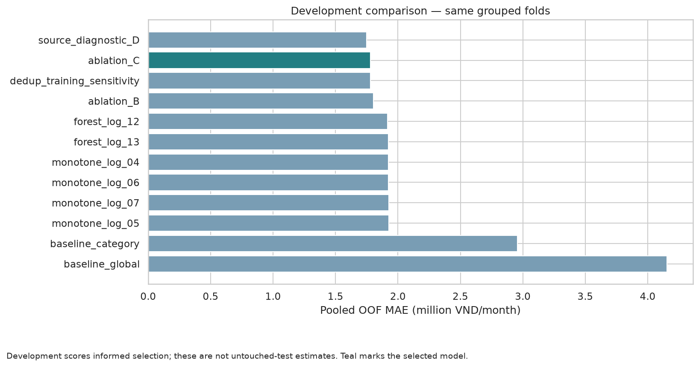
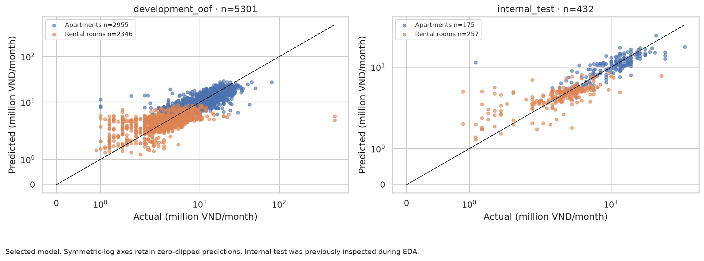
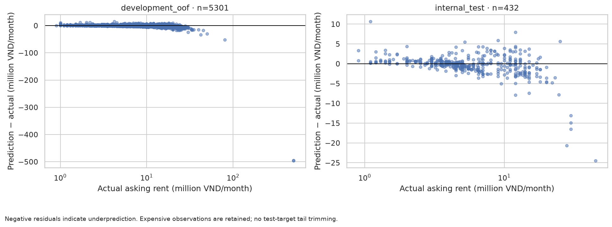
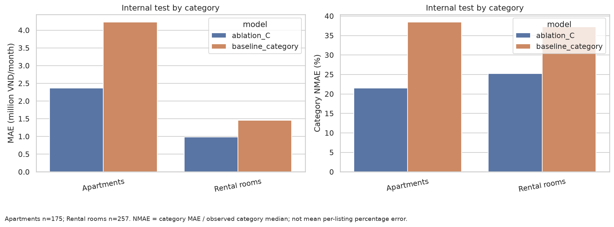
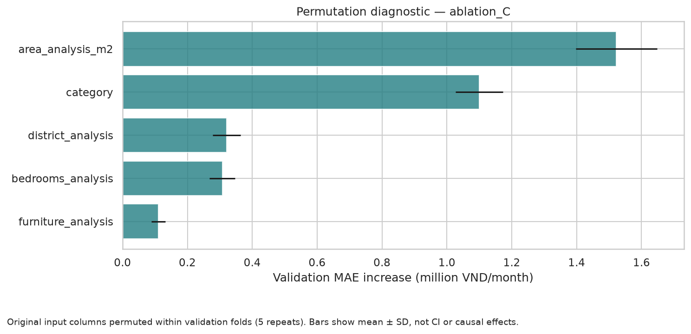

# Modeling report — Hanoi rental asking-price estimation

**Selected model: ablation_C.** Internal-test MAE: **1.544 million VND/month**, compared with **2.578 million** for the category-median baseline (+40.1% improvement). RMSE: 2.779 million; R²: 0.735. MAE is primary; R² is supplementary.

The internal test comes from a snapshot already inspected in EDA. It was excluded from model fitting and selection, but is not a genuinely unseen external validation sample. Results concern asking rents for eligible listings, not transactions or the entire Hanoi market.

## 1. Data, bounded review and frozen splits

Persisted audit-queue decisions are applied before splitting, with context validation. Automated audit flags quarantine unresolved cases in the current snapshot. Manual evidence is CSV-only, not webpage verification; no numeric price threshold exclusion.

Eligible input after review: 5733 listings in 5576 candidate groups. Development: 5301; internal test: 432. No P1/P99 target trimming. The processed CSV contains apartments and rooms. Review changes were applied through the audit queue.

| partition | category | source | n | groups |
| --- | --- | --- | --- | --- |
| development | Apartments | alonhadat | 975 | 973 |
| development | Apartments | nhatot | 1980 | 1840 |
| development | Rental rooms | alonhadat | 227 | 223 |
| development | Rental rooms | nhatot | 2119 | 2109 |
| internal_test | Apartments | alonhadat | 96 | 96 |
| internal_test | Apartments | nhatot | 79 | 79 |
| internal_test | Rental rooms | alonhadat | 69 | 69 |
| internal_test | Rental rooms | nhatot | 188 | 187 |

Fold policy: `GroupKFold(shuffle=True, random_state=42)`. Balance rule: Every training/validation category share >=50% of development share; category-stratified grouped fallback if needed. Source coverage was inspected separately. Group isolation takes priority over exact category proportions. Counts and group counts for all train/validation cells are saved in `modeling_fold_coverage.csv`.

| category | source | n | groups | fold | role |
| --- | --- | --- | --- | --- | --- |
| Apartments | alonhadat | 197 | 197 | 0 | validation |
| Apartments | nhatot | 419 | 375 | 0 | validation |
| Rental rooms | alonhadat | 45 | 45 | 0 | validation |
| Rental rooms | nhatot | 413 | 412 | 0 | validation |
| Apartments | alonhadat | 205 | 205 | 1 | validation |
| Apartments | nhatot | 361 | 338 | 1 | validation |
| Rental rooms | alonhadat | 42 | 42 | 1 | validation |
| Rental rooms | nhatot | 449 | 444 | 1 | validation |
| Apartments | alonhadat | 169 | 168 | 2 | validation |
| Apartments | nhatot | 403 | 383 | 2 | validation |
| Rental rooms | alonhadat | 51 | 51 | 2 | validation |
| Rental rooms | nhatot | 427 | 427 | 2 | validation |
| Apartments | alonhadat | 211 | 210 | 3 | validation |
| Apartments | nhatot | 416 | 379 | 3 | validation |
| Rental rooms | alonhadat | 51 | 50 | 3 | validation |
| Rental rooms | nhatot | 393 | 390 | 3 | validation |
| Apartments | alonhadat | 193 | 193 | 4 | validation |
| Apartments | nhatot | 381 | 365 | 4 | validation |
| Rental rooms | alonhadat | 38 | 35 | 4 | validation |
| Rental rooms | nhatot | 437 | 436 | 4 | validation |

## 2. Features, targets and experiment protocol

Selected input schema: `['category', 'district_analysis', 'area_analysis_m2', 'bedrooms_analysis', 'furniture_analysis']`. Target: positive monthly rent in VND. Selected target transform: `log`. Parameters: `{'max_leaf_nodes': 15, 'min_samples_leaf': 20}`.

Numeric medians, missing indicators, one-hot vocabularies and Ridge scaling are fitted on training folds only. Entirely missing numeric columns retain a zero placeholder plus a missing indicator. Bedrooms/furnishing are optional; bathrooms are deferred. A missingness pattern may proxy source even when source itself is excluded.

Predictors use an explicit whitelist. Price fields, target transformations, title, IDs and audit/review flags are excluded. Unknown districts are encoded without crashing and flagged at inference. Unsupported categories, invalid numeric area/counts and unsupported area units are rejected.

Nonnegative policy: `max(raw_prediction_vnd, 0); non-finite predictions rejected`. Clipping is inside the persisted estimator. Raw/final predictions and clipping indicators are retained; no observed train/test minimum is used as a floor.

Two baselines were fitted inside each fold. Diagnostics: 8 Ridge and 16 unconstrained Random Forest configurations. Deployable grid: 8 monotonic histogram boosting and 4 monotonic Random Forest configurations with direct/log targets, sharing five grouped folds. Deployable models are fitted separately by category and omit bedrooms when training coverage is below 35%. The leading constrained core configuration was held fixed for B/C feature ablations; source inclusion and deduplicated-training sensitivity remained development-only diagnostics.

Selection tie policy: Candidates within 1% of best OOF MAE: favor Ridge, then fewer features, then MAE. A candidate qualifies if OOF MAE improves by at least 10% over the category baseline and no category MAE worsens by more than 10%. The baseline is retained otherwise. No metric or population was changed after viewing internal-test errors.

## 3. Development results and selection

| model | feature_set | target | mae_vnd | rmse_vnd | r2 | fold_mae_std_vnd | clipping_count | runtime_seconds |
| --- | --- | --- | --- | --- | --- | --- | --- | --- |
| source_diagnostic_D | D | log | 1,747,629.81 | 9,967,862.04 | 0.17 | 279,941.48 | 0 | 1.72 |
| ablation_C | C | log | 1,779,878.48 | 9,979,108.72 | 0.17 | 284,990.28 | 0 | 1.61 |
| dedup_training_sensitivity | C | log | 1,780,191.11 | 9,978,465.32 | 0.17 | 288,118.05 | 0 | 1.65 |
| ablation_B | B | log | 1,804,816.05 | 9,989,611.21 | 0.17 | 272,171.50 | 0 | 1.57 |
| forest_log_12 | A | log | 1,917,285.35 | 10,046,775.86 | 0.16 | 271,842.87 | 0 | 1.96 |
| forest_log_13 | A | log | 1,922,604.36 | 10,049,033.89 | 0.16 | 266,986.23 | 0 | 2.42 |
| monotone_log_04 | A | log | 1,922,891.44 | 10,041,641.31 | 0.16 | 269,058.06 | 0 | 1.58 |
| monotone_log_06 | A | log | 1,924,149.43 | 10,041,531.91 | 0.16 | 266,942.46 | 0 | 2.26 |
| monotone_log_07 | A | log | 1,925,610.54 | 10,043,532.25 | 0.16 | 262,710.26 | 0 | 1.92 |
| monotone_log_05 | A | log | 1,927,257.33 | 10,044,773.20 | 0.16 | 264,631.22 | 0 | 1.55 |
| forest_log_14 | A | log | 1,932,031.11 | 10,053,641.72 | 0.16 | 264,475.95 | 0 | 1.67 |
| forest_log_15 | A | log | 1,942,081.13 | 10,057,064.88 | 0.16 | 264,894.73 | 0 | 2.06 |
| monotone_forest_log_02 | A | log | 1,942,109.46 | 10,048,995.61 | 0.16 | 264,903.13 | 0 | 2.73 |
| forest_log_08 | A | log | 1,942,453.82 | 10,054,237.42 | 0.16 | 272,315.52 | 0 | 1.58 |
| forest_log_09 | A | log | 1,950,593.62 | 10,057,055.30 | 0.16 | 268,382.40 | 0 | 1.87 |
| forest_log_10 | A | log | 1,952,248.38 | 10,058,908.76 | 0.16 | 266,854.36 | 0 | 1.55 |
| monotone_forest_log_03 | A | log | 1,959,970.93 | 10,059,035.11 | 0.16 | 261,414.59 | 0 | 2.53 |
| forest_log_11 | A | log | 1,964,198.72 | 10,061,939.05 | 0.16 | 268,535.28 | 0 | 1.81 |
| forest_direct_04 | A | direct | 2,079,747.83 | 10,072,297.91 | 0.16 | 225,745.19 | 0 | 2.00 |
| monotone_direct_02 | A | direct | 2,083,516.32 | 10,069,085.02 | 0.16 | 217,180.01 | 0 | 2.24 |
| monotone_direct_00 | A | direct | 2,085,216.72 | 10,069,271.42 | 0.16 | 219,547.82 | 0 | 1.58 |
| forest_direct_05 | A | direct | 2,090,942.50 | 10,078,850.10 | 0.15 | 226,788.57 | 0 | 2.42 |
| monotone_direct_01 | A | direct | 2,093,696.14 | 10,071,959.03 | 0.16 | 216,469.67 | 0 | 1.54 |
| monotone_direct_03 | A | direct | 2,094,556.61 | 10,071,942.12 | 0.16 | 217,465.36 | 0 | 1.84 |
| forest_direct_06 | A | direct | 2,095,187.45 | 10,076,073.14 | 0.15 | 216,240.98 | 0 | 1.67 |
| monotone_forest_direct_00 | A | direct | 2,104,326.09 | 10,074,476.24 | 0.15 | 222,251.89 | 0 | 2.68 |
| forest_direct_00 | A | direct | 2,106,443.71 | 10,077,515.60 | 0.15 | 226,322.88 | 0 | 1.57 |
| forest_direct_07 | A | direct | 2,109,641.58 | 10,086,526.77 | 0.15 | 217,962.69 | 0 | 2.05 |
| monotone_forest_direct_01 | A | direct | 2,113,432.29 | 10,077,302.13 | 0.15 | 219,608.48 | 0 | 2.53 |
| forest_direct_02 | A | direct | 2,114,880.54 | 10,080,251.46 | 0.15 | 219,332.19 | 0 | 1.54 |
| forest_direct_01 | A | direct | 2,116,521.71 | 10,084,133.22 | 0.15 | 231,580.53 | 0 | 1.85 |
| forest_direct_03 | A | direct | 2,128,291.27 | 10,089,897.25 | 0.15 | 220,781.00 | 0 | 1.82 |
| ridge_direct_a100 | A | direct | 2,257,868.75 | 10,110,906.41 | 0.15 | 219,344.10 | 0 | 0.12 |
| ridge_direct_a10 | A | direct | 2,277,669.82 | 10,111,330.10 | 0.15 | 219,496.98 | 0 | 0.12 |
| ridge_log_a0.1 | A | log | 2,282,302.10 | 11,062,003.96 | -0.02 | 277,077.35 | 0 | 0.12 |
| ridge_log_a1 | A | log | 2,282,565.46 | 11,063,597.34 | -0.02 | 276,931.69 | 0 | 0.12 |
| ridge_direct_a1 | A | direct | 2,282,810.33 | 10,112,034.83 | 0.15 | 219,394.68 | 0 | 0.12 |
| ridge_direct_a0.1 | A | direct | 2,283,206.68 | 10,112,180.43 | 0.15 | 219,275.21 | 1 | 0.12 |
| ridge_log_a10 | A | log | 2,285,051.20 | 11,073,515.92 | -0.02 | 277,973.30 | 0 | 0.15 |
| ridge_log_a100 | A | log | 2,301,860.81 | 11,143,501.97 | -0.03 | 281,800.73 | 0 | 0.18 |
| baseline_category | A | direct | 2,958,283.19 | 10,514,160.99 | 0.08 | 197,281.13 | 0 | 0.09 |
| baseline_global | A | direct | 4,153,520.67 | 11,103,202.18 | -0.03 | 238,610.92 | 0 | 0.09 |

Best source-free candidate: **ablation_C**. OOF improvement: **39.8%**. Practical rule passed: **True**. Category MAE changes relative to the baseline (negative is better): `{'can_ho_chung_cu': -47.7603583943814, 'nha_tro': -15.638948470968039}`.

OOF estimates were used for selection and are development estimates, not unbiased final performance claims. Per-fold SD is descriptive, not a confidence interval.

## 4. Locked internal-test evaluation

| model | partition | n | mae_vnd | rmse_vnd | r2 | median_ae_vnd | p90_ae_vnd | improvement_vs_category_baseline_pct | clipping_count |
| --- | --- | --- | --- | --- | --- | --- | --- | --- | --- |
| baseline_global | internal_test | 432 | 3,829,652.78 | 5,450,296.48 | -0.02 | 2,800,000.00 | 7,700,000.00 | -48.55 | 0 |
| baseline_category | internal_test | 432 | 2,578,032.41 | 4,177,926.48 | 0.40 | 1,800,000.00 | 5,500,000.00 | 0.00 | 0 |
| ablation_C | internal_test | 432 | 1,544,409.34 | 2,779,397.04 | 0.74 | 876,580.73 | 3,311,282.60 | 40.09 | 0 |

All models in this table use the same test rows. No test-derived tuning, target trimming or post-test refit was performed. R² retains negative values and is undefined for constant targets or fewer than two observations. MAE, RMSE and other absolute errors are in VND/month.

## 5. Subgroup errors and normalized interpretation

Category NMAE is category MAE divided by the observed median price of the same evaluated category rows. It is a descriptive scale diagnostic, not MAPE and not the selection metric. Groups below 10 show counts only; groups of 10–29 are exploratory.

| model | partition | dimension | group | n | comparison_tier | mae_vnd | rmse_vnd | r2 | median_ae_vnd | p90_ae_vnd | median_price_vnd | nmae_pct |
| --- | --- | --- | --- | --- | --- | --- | --- | --- | --- | --- | --- | --- |
| ablation_C | internal_test | category | Apartments | 175 | main | 2,364,807.79 | 3,758,672.76 | 0.58 | 1,788,244.26 | 4,354,014.21 | 11,000,000.00 | 21.50 |
| ablation_C | internal_test | category | Rental rooms | 257 | main | 985,772.26 | 1,834,480.65 | 0.38 | 628,183.61 | 2,154,859.45 | 3,900,000.00 | 25.28 |
| ablation_C | internal_test | source | alonhadat | 165 | main | 2,095,184.55 | 3,837,580.80 | 0.69 | 1,235,278.05 | 3,693,521.68 | 10,000,000.00 | 20.95 |
| ablation_C | internal_test | source | nhatot | 267 | main | 1,204,042.64 | 1,843,361.76 | 0.65 | 707,399.68 | 2,752,895.55 | 4,500,000.00 | 26.76 |
| ablation_C | internal_test | area_available | False | 93 | main | 1,104,121.82 | 1,665,707.79 | 0.38 | 751,833.56 | 2,548,775.72 | 4,600,000.00 | 24.00 |
| ablation_C | internal_test | area_available | True | 339 | main | 1,665,196.18 | 3,013,824.85 | 0.74 | 935,990.05 | 3,411,021.95 | 5,200,000.00 | 32.02 |
| ablation_C | internal_test | unseen_district | False | 432 | main | 1,544,409.34 | 2,779,397.04 | 0.74 | 876,580.73 | 3,311,282.60 | 5,000,000.00 | 30.89 |
| ablation_C | internal_test | source_category | alonhadat/can_ho_chung_cu | 96 | main | 2,742,082.52 | 4,449,771.52 | 0.43 | 1,996,798.37 | 4,561,120.14 | 13,000,000.00 | 21.09 |
| ablation_C | internal_test | source_category | alonhadat/nha_tro | 69 | main | 1,195,152.58 | 2,769,174.42 | 0.41 | 585,674.85 | 2,335,883.85 | 3,600,000.00 | 33.20 |
| ablation_C | internal_test | source_category | nhatot/can_ho_chung_cu | 79 | main | 1,906,347.36 | 2,689,616.38 | 0.51 | 1,582,591.24 | 4,243,627.08 | 7,500,000.00 | 25.42 |
| ablation_C | internal_test | source_category | nhatot/nha_tro | 188 | main | 908,925.23 | 1,336,422.03 | 0.32 | 642,321.47 | 2,131,416.75 | 3,900,000.00 | 23.31 |

Development category comparison:

| model | partition | dimension | group | n | comparison_tier | mae_vnd | rmse_vnd | r2 | median_ae_vnd | p90_ae_vnd | median_price_vnd | nmae_pct |
| --- | --- | --- | --- | --- | --- | --- | --- | --- | --- | --- | --- | --- |
| ablation_C | development_oof | category | Apartments | 2955 | main | 2,088,206.93 | 3,263,585.40 | 0.62 | 1,369,133.12 | 4,650,287.42 | 10,000,000.00 | 20.88 |
| ablation_C | development_oof | category | Rental rooms | 2346 | main | 1,391,510.80 | 14,546,479.37 | 0.01 | 664,233.05 | 2,074,575.17 | 4,000,000.00 | 34.79 |
| baseline_category | development_oof | category | Apartments | 2955 | main | 3,997,360.74 | 5,407,218.04 | -0.03 | 3,010,000.00 | 8,000,000.00 | 10,000,000.00 | 39.97 |
| baseline_category | development_oof | category | Rental rooms | 2346 | main | 1,649,470.67 | 14,593,298.90 | -0.00 | 1,000,000.00 | 2,500,000.00 | 4,000,000.00 | 41.24 |

## 6. Source and duplicate sensitivity

| model | partition | n | mae_vnd | rmse_vnd | r2 | median_ae_vnd | p90_ae_vnd | improvement_vs_category_baseline_pct | clipping_count |
| --- | --- | --- | --- | --- | --- | --- | --- | --- | --- |
| ablation_C | development_oof | 5301 | 1,779,878.48 | 9,979,108.72 | 0.17 | 971,325.28 | 3,585,186.59 | 39.83 | 0 |
| source_diagnostic_D | development_oof | 5301 | 1,747,629.81 | 9,967,862.04 | 0.17 | 958,059.81 | 3,511,309.69 | 40.92 | 0 |
| dedup_training_sensitivity | development_oof | 5301 | 1,780,191.11 | 9,978,465.32 | 0.17 | 975,463.25 | 3,586,540.65 | 39.82 | 0 |

Source inclusion may capture differences in collection or listing composition rather than transferable property attributes. The source-aware variant is not the main artifact. Duplicate sensitivity changes training membership only; validation membership stays fixed. Candidate groups are not verified unique properties, and reworded reposts may remain undetected.

## 7. Largest development errors and interpretation

These ten records were selected using OOF absolute errors before internal-test scoring. Titles and audit notes support contextual inspection without changing eligibility, models or predictions. Possible remaining commercial-scope contamination limits interpretation and motivates a separately audited future snapshot. Original Vietnamese titles are retained as evidence.

| listing_id | category | actual_vnd | prediction_vnd | absolute_error_vnd | title |
| --- | --- | --- | --- | --- | --- |
| nt_135138477 | Rental rooms | 500,000,000.00 | 4,002,666.85 | 495,997,333.15 | Nhà trọ Hoàng Văn Thái, Thanh Xuân, 5xx triệu |
| nt_135118826 | Rental rooms | 500,000,000.00 | 4,915,268.63 | 495,084,731.37 | Phòng trọ Đống Đa full đồ |
| alo_19185973 | Apartments | 80,000,000.00 | 27,529,287.40 | 52,470,712.60 | SIÊU PHẨM DUPLEX STARLAKE – ĐẲNG CẤP THÔNG TẦNG THƯỢNG LƯU, KÈM SLOT Ô TÔ |
| nt_135007842 | Apartments | 42,000,000.00 | 8,814,715.73 | 33,185,284.27 | Cho thuê căn hộ 2PN Masteri West Heights, full đồ |
| alo_19185736 | Apartments | 50,000,000.00 | 20,294,136.32 | 29,705,863.68 | SIÊU PHẨM STARLAKE – LÔ GÓC THOÁNG ĐẸP, CÓ SLOT Ô TÔ - FULL NỘI THẤT |
| nt_134991971 | Apartments | 30,000,000.00 | 5,940,513.78 | 24,059,486.22 | Cho thuê căn Duplex full Hinode City - 201 Minh Khai |
| alo_19051711 | Rental rooms | 23,000,000.00 | 5,383,147.33 | 17,616,852.67 | Cho thuê CHDV mặt phố Hai Bà Trưng, 100m2, 2PN - 1 WC, Ban công thoáng, Nội thất VIP |
| nt_135483863 | Apartments | 24,000,000.00 | 6,583,023.95 | 17,416,976.05 | Cho thuê căn hộ 3PN Hoàng Mai, full nội thất, có thang máy |
| nt_135088384 | Rental rooms | 22,000,000.00 | 4,626,886.77 | 17,373,113.23 | Sang nhượng CCMN |
| alo_16666979 | Apartments | 45,000,000.00 | 27,651,814.19 | 17,348,185.81 | Cho thuê căn hộ E5 Ciputra, 153m2,4pn, đủ đồ hiện đại, giá 45 triệu/tháng |

The permutation diagnostic uses original columns on held-out validation folds, keeping each one-hot expansion together. Correlated inputs can substitute for one another; importance is not causal. It explains the leading source-free candidate, even if the practical rule retains a baseline.

## 8. Artifact, reproducibility and limitations

- `artifacts/rental_price_pipeline.joblib` contains input validation, learned preprocessing, target inversion and clipping. It was fitted on development only, not silently refitted on all data. Reloaded predictions were checked against the fitted object.

- `artifacts/model_selection.json` records the decision made before internal-test scoring. `model_metadata.json` records data/code fingerprints, dependency versions, seed and the split policy.

- Rerunning the notebook reuses the frozen experiment when its data/code/dependencies match. It regenerates the report/figures without re-scoring the internal test. A changed snapshot requires a separately documented experiment.

- Remaining source bias, incomplete fields and imperfect duplicate detection limit generalization. The bounded pre-model scope review is subjective CSV-only curation, not verified ground truth.

- Missing-area and unseen-district performance is reported where enough observations exist; unsupported or very small groups do not establish reliable deployment accuracy.

- Predictions are point estimates of asking rent, with no calibrated uncertainty interval. Prefer a genuinely new snapshot for stronger evaluation. Optional cross-source transfer and temporal extensions were not performed in v1.

- The deployment benchmark is frozen and excluded from training, including candidate duplicate peers. It is reused for operational regression checks and has already been inspected; it is not fresh external validation. Future temporal validation remains necessary.

## 9. Figures

### 01_development_comparison

### 02_predictions

### 03_residuals

### 04_category_errors

### 05_permutation_importance

